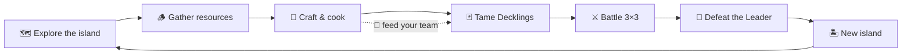

# 🃏 Decklings

**Tame magical creatures, build your deck, and become the Deckling Champion!**

*Survival · Deckbuilding · Creature Collector · Crafting*

 

 

[About](#-about) •
[Features](#-features) •
[Gameplay Loop](#-gameplay-loop) •
[System Requirements](#-system-requirements) •
[Links](#-links)

---

## 🌿 About

**Decklings** is a cozy yet challenging survival card game with deckbuilding at its core. Explore wild biomes across a chain of islands, gather resources, cook hearty meals, and build up your base while taming magical creatures — **Decklings** — and leading them into battle.

  

 

| | |
|:--|:--|
| 🎮 **Developer** | [Dark Lizard Games](https://store.steampowered.com/developer/darklizardgames) |
| 📦 **Publisher** | [2 Left Thumbs](https://store.steampowered.com/publisher/2leftthumbs) |
| 📅 **Release Date** | September 25, 2026 |
| 🏷️ **Genres** | Adventure, Casual, RPG, Simulation, Strategy |
| 🌐 **Languages** | English, Português (Brasil) |
| 🏆 **Steam Features** | Achievements, Family Sharing |

---

## ✨ Features

<table>
<tr>
<td width="50%" valign="top">

### 🗺️ Explore & Collect
- Unique islands with diverse biomes, resources, and inhabitants
- **100+** unique Decklings to tame
- Tame creatures by **combining cards**
- Level up your Decklings to learn new moves or upgrade existing ones
- ✨ Hunt for rare **holo** Decklings

</td>
<td width="50%" valign="top">

### ⚔️ Card Duels
- Battle other tamers on a **3×3** board
- Experiment with team compositions and discover synergies
- Defeat **Team Leaders** to unlock new islands
- Rise through the ranks to claim the title of **Deckling Champion**

</td>
</tr>
<tr>
<td width="50%" valign="top">

### 🔨 Crafting & Base Building
- **Stack cards** to craft items: food, equipment, and stations
- Learn new recipes as your journey progresses
- Equipment grants special bonuses and buffs in battle

</td>
<td width="50%" valign="top">

### 🍲 Survival & Automation
- Cook meals to feed your Decklings — or they **might run away**!
- Automate production: plantation fields, logging sites, feeders, and much more

</td>
</tr>
</table>

---

## 🔄 Gameplay Loop

---

## 💻 System Requirements

<b>Minimum</b> (click to expand)

 

| Component | Requirement |
|:--|:--|
| OS | Windows 10 (64-bit) |
| Processor | 2 GHz, 64-bit |
| Memory | 1 GB RAM |
| Graphics | DirectX 9 compatible, 1 GB VRAM or more |
| Storage | 1 GB available space |

<b>Recommended</b>

 

Requires a 64-bit processor and operating system.

---

## 🔗 Links

---

**Enjoying the game? Add it to your wishlist and give this repo a ⭐!**

Decklings © Dark Lizard Games / 2 Left Thumbs. All images and trademarks belong to their respective owners.

